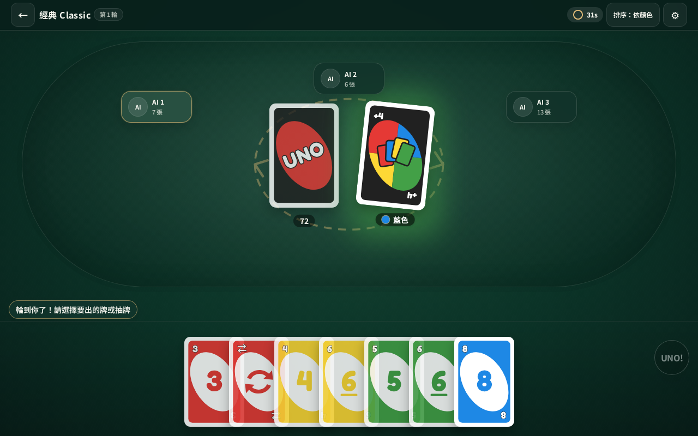
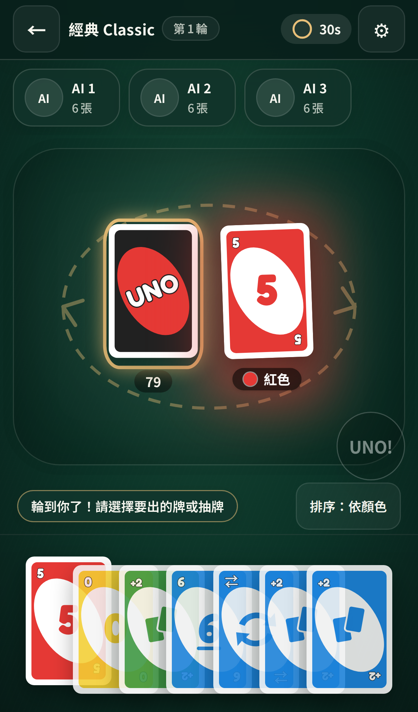

# UNO Web

網頁版 UNO：支援多種遊戲模式與自訂房規、區網多人連線（手機掃 QR Code 即開即玩）、戰績/排行榜/每日挑戰與重播檢視。AI 以搜尋演算為主：簡單（隨機）、普通（啟發式）、困難（記牌 + ISMCTS 蒙地卡羅搜尋）。




## 快速開始

```bash
# 1. 安裝工具鏈與專案依賴（Rust、wasm-pack、pnpm 套件）
./scripts/setup.sh

# 2. 一鍵啟動伺服器（建置 WASM/型別/前端後啟動，手機掃終端 QR 加入）
./scripts/start.sh

# 3. 執行全部品質檢查（fmt、clippy、test、lint、typecheck）
./scripts/check.sh
```

手機使用：主機與手機連同一 Wi-Fi，執行 `./scripts/start.sh` 後掃描終端機印出的 QR Code（或房間大廳內的房間 QR）即可在手機瀏覽器加入房間，不需安裝 App；加入主畫面後可以 PWA 全螢幕遊玩。

Docker 啟動（區網 IP/QR 以 host 網路正確偵測，資料存 `./data`）：

```bash
docker compose up -d --build
```

## 線上單機版 (GitHub Pages)

本專案支援純靜態部署，可直接透過 GitHub Pages 線上遊玩完整單機版（包含 8 種模式、AI 對戰、音效、PWA 離線快取與本地重播）：

- **線上體驗網址**：`https://kyle0518.github.io/UNO/`
- **本機建置 Pages 靜態包**：`./scripts/build-pages.sh`
- **自動部署**：已配置 GitHub Actions 工作流程（`.github/workflows/deploy.yml`），推送到 `main` 分支時會自動編譯 WASM 並發佈至 GitHub Pages。
- **SPA 路由支援**：內建 `.nojekyll` 與 `404.html` fallback，確保直接重新整理或分享子路由連結（如 `/rules`、`/settings`）時正常載入。

### 常用腳本
- `./scripts/setup.sh`：安裝 Rust 工具鏈、WASM target、`wasm-pack` 與 workspace 依賴。
- `./scripts/start.sh`：一鍵建置並啟動 `uno-server`（正式版）。
- `./scripts/check.sh`：執行 Rust / 前端測試、型別與 lint 檢查。
- `./scripts/build-pages.sh`：編譯 WASM 並建置可發佈至 GitHub Pages 的前端靜態檔案。
- `./scripts/gen-types.sh`：從 Rust 型別產生 TypeScript 型別到 `apps/web/src/generated/`。
- `./scripts/build-wasm.sh`：建置 `uno-wasm` 到 `apps/web/src/wasm/pkg/`。

## 文件

| 文件 | 內容 |
|------|------|
| [AGENTS.md](AGENTS.md) | 實作者工作守則 — **開工前先讀** |
| [docs/SPEC.md](docs/SPEC.md) | 產品規格、架構、設計系統與手機畫面規格 |
| [docs/RULES.md](docs/RULES.md) | 完整遊戲規則與各模式牌組、計分（引擎唯一依據） |
| [docs/INTERFACES.md](docs/INTERFACES.md) | Rust 型別、WASM API、WebSocket 協議與資料庫結構 |
| [docs/PLAN.md](docs/PLAN.md) | 逐任務實作計畫與驗收指令 |
| [docs/PROGRESS.md](docs/PROGRESS.md) | 實作進度追蹤 |

## 技術棧
Rust 規則引擎（`uno-core` → WASM / 原生伺服器）· 搜尋型 AI（`uno-bots`：Random / Heuristic / ISMCTS）· React 19 + Vite + Tailwind CSS 4 · axum + SQLite
