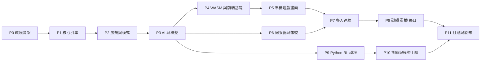

# 實作計畫（PLAN）

> 給實作者（AI）：**一次只做一個任務**。每個任務開始前讀「需要閱讀」列出的章節；完成後執行「驗收」指令全部通過，再到 [PROGRESS.md](PROGRESS.md) 勾選並寫一行筆記。不要跳任務、不要合併任務。工作守則見 [AGENTS.md](../AGENTS.md)。

階段相依：

---

## P0 — 環境與專案骨架

### T0.1 安裝工具鏈
- 需要閱讀：SPEC §3.3、§4
- 步驟：
  1. 建立 `scripts/setup.sh`（bash，`set -euo pipefail`），內容依序：
     - 若無 `cargo`：`curl --proto '=https' --tlsv1.2 -sSf https://sh.rustup.rs | sh -s -- -y --profile minimal` 並 `source "$HOME/.cargo/env"`。
     - `rustup component add rustfmt clippy`、`rustup target add wasm32-unknown-unknown`
     - 若無 `wasm-pack`：`cargo install wasm-pack --locked`
     - 若無 `uv`：`curl -LsSf https://astral.sh/uv/install.sh | sh`
     - `pnpm install`（根目錄）
     - `cd python && uv venv --python 3.12 .venv && uv pip install -p .venv maturin`（P9 前此步可以先跳過：判斷 `python/pyproject.toml` 存在才執行）
  2. `chmod +x scripts/setup.sh` 並執行。
- 驗收：`cargo --version && wasm-pack --version && pnpm --version` 都有輸出。

### T0.2 Rust workspace
- 步驟：
  1. 根目錄 `Cargo.toml`：`[workspace] resolver = "2"`，`members = ["crates/*"]`；`[workspace.package] version = "0.1.0", edition = "2021"`；`[workspace.dependencies]` 列出 serde（features derive）、serde_json、thiserror、ts-rs（features `serde-compat`）、proptest。
  2. `[profile.release] lto = "thin"`；`[profile.release.package.uno-wasm] opt-level = "s"`。
  3. 用 `cargo new --lib` 建立 `crates/uno-core`、`uno-bots`、`uno-protocol`、`uno-wasm`、`uno-py`；`cargo new` 建立 `crates/uno-server`、`crates/uno-sim`（binary）。每個 crate 用 `version.workspace = true` 等。
  4. `rustfmt.toml`：`max_width = 100`。
  5. `.gitignore`：`target/`、`node_modules/`、`dist/`、`apps/web/src/wasm/pkg/`、`data/`、`python/.venv/`、`*.pyc`、`__pycache__/`、`runs/`、`*.so`。
- 驗收：`cargo build --workspace && cargo test --workspace`。

### T0.3 前端骨架
- 步驟：
  1. 根目錄 `package.json`（`"private": true`，`packageManager` 填目前 pnpm 版本）、`pnpm-workspace.yaml`（`packages: ["apps/*"]`）。
  2. `pnpm create vite apps/web --template react-ts`，然後在 `apps/web` 安裝：`tailwindcss @tailwindcss/vite motion zustand react-router qrcode howler` 與 dev：`vitest @testing-library/react @testing-library/jest-dom jsdom @types/qrcode @types/howler eslint prettier vite-plugin-wasm vite-plugin-top-level-await`。
  3. `vite.config.ts`：plugins `react()`, `tailwindcss()`, `wasm()`（Vite 8 使用 Rolldown，不需 `vite-plugin-top-level-await`，且 `--target web` 使用顯式 `init()`）；`server: { host: true, port: 5173, proxy: { '/api': 'http://localhost:8787', '/ws': { target: 'ws://localhost:8787', ws: true }, '/models': 'http://localhost:8787' } }`；`worker: { format: 'es', plugins: () => [wasm()] }`；vitest `environment: 'jsdom'`。
  4. `tsconfig` 開 `strict: true`、`noUncheckedIndexedAccess: true`；路徑別名 `@/* → src/*`。
  5. `package.json` scripts：`dev`、`build`（`tsc -b && vite build`）、`preview`、`test`（`vitest run`）、`lint`（`eslint .`）、`typecheck`（`tsc -b --noEmit`）。
  6. 清空範例內容，`App.tsx` 顯示「UNO」標題即可。
- 驗收：`pnpm -C apps/web build && pnpm -C apps/web test --passWithNoTests && pnpm -C apps/web lint`。

### T0.4 開發腳本
- 步驟：建立 `scripts/check.sh`（依序跑 SPEC §8 的所有品質門檻；尚未存在的部分用 `if [ -d ... ]` 判斷略過）、`scripts/gen-types.sh`（`cargo test -p uno-core -p uno-protocol export_bindings` → ts-rs 輸出到 `apps/web/src/generated/`；用環境變數 `TS_RS_EXPORT_DIR`）、`scripts/build-wasm.sh`（`wasm-pack build crates/uno-wasm --target web --out-dir ../../apps/web/src/wasm/pkg --release`）。
- 驗收：`./scripts/check.sh` 結束碼 0。

### T0.5 文件
- 步驟：更新 `README.md`：專案介紹、`./scripts/setup.sh`、`./scripts/check.sh` 用法、文件連結。
- 驗收：人工檢查連結正確。

---

## P1 — 核心引擎（Classic 規則）

> 全部在 `crates/uno-core`。每個任務都要附測試，測試函式名含 RULES 編號。

### T1.1 RNG
- 需要閱讀：INTERFACES §1.4
- 檔案：`src/rng.rs`
- 步驟：實作 `Rng { s: [u64; 4] }`、`Rng::new(seed)`（SplitMix64）、`next_u64`、`below`、`shuffle<T>(&mut self, v: &mut [T])`、`derive_Serialize/Deserialize/Clone/Debug/PartialEq`。
- 測試：同 seed 序列相同；不同 seed 不同；`below(n) < n`（proptest）；seed=0 前三個值的回歸測試。
- 驗收：`cargo test -p uno-core rng`。

### T1.2 卡牌型別與牌點
- 需要閱讀：INTERFACES §1.1、RULES §2.1、§2.9.1、§4.1.10、§4.2.9
- 檔案：`src/card.rs`
- 步驟：定義 `Color`、`Face`、`CardFace`、`Card`、`Side`；`Color::slot()`；`CardFace::is_wild()`、`CardFace::draw_value() -> Option<u16>`（DrawTwo=2…WildDrawTen=10；非抽牌卡 None）；`fn points(face: &CardFace, mode: ModeKind, side: Side) -> u32`；`Card::face(side) -> CardFace`（Light 回 light；Dark 回 `dark.unwrap()`）。所有型別加 `#[derive(TS)] #[ts(export)]`。
- 測試：每種牌點值。
- 驗收：`cargo test -p uno-core card`。

### T1.3 設定
- 需要閱讀：INTERFACES §1.2、RULES §3、§4
- 檔案：`src/config.rs`
- 步驟：實作所有 enum 與 `RuleConfig`；`preset()` 涵蓋 RULES §4 表格中**所有** mode_id；`validate()`：人數範圍（依模式）、teams 只允許 4/6 人、Flip 強制 `stack_draw=None, seven_zero=false`、NoMercy 強制 R4.2.2、stack_draw≠None 時 `wild4_rule=Challenge` 改為 `Free`、`uno_rule=Auto` 時 penalty 無效但保留值。
- 測試：每個 preset 通過 validate；非法人數回錯。
- 驗收：`cargo test -p uno-core config`。

### T1.4 牌組建構
- 需要閱讀：RULES §2.1、§4.1.2–4.1.4、§4.2.1
- 檔案：`src/deck.rs`
- 步驟：`pub fn build_deck(config: &RuleConfig, rng: &mut Rng) -> Vec<Card>`：依 ModeKind 建牌，CardId 依規定順序；`deck_count` 複製；Flip 時用 rng 洗暗面列表後配對。
- 測試：張數（108/112/168、deck_count=2 為 216）；每種牌面張數；CardId 連續 0..n；Flip 同 seed 配對相同、不同 seed 不同。
- 驗收：`cargo test -p uno-core deck`。

### T1.5 GameState 建構與發牌
- 需要閱讀：INTERFACES §1.3、RULES §2.2
- 檔案：`src/state.rs`、`src/events.rs`
- 步驟：
  1. 定義 `Phase`、`Action`、`Event`、`DrawReason`、`EliminationReason`、`EngineError`（含 TS derive）。
  2. `GameState` 欄位如 INTERFACES 註解；`new(config, seed)`：validate → `Rng::new(seed)` → build_deck → 洗牌（draw_pile 末端為頂）→ 發牌 → 翻起始牌並套用 R2.2.6 → 記錄 `initial_events`。
  3. 測試專用建構：`#[cfg(any(test, feature = "testing"))] pub fn new_with_deck(config, draw_order: Vec<CardId>)`：牌堆依給定順序（第一個元素最先被抽），讓測試能控制發牌與起始牌。`Cargo.toml` 新增 `[features] testing = []`。
  4. 共用輔助：`next_seat(from, steps)`（跳過淘汰者）、`draw_cards(seat, n, reason) -> Event`（R2.5.5、R2.5.7）、`top_card()`。
- 測試：R2.2.3 每人 7 張；R2.2.6 六種起始牌各一個測試；牌數守恆。
- 驗收：`cargo test -p uno-core state`。

### T1.6 合法動作
- 需要閱讀：RULES §2.3、§2.5、§2.6、§2.7
- 檔案：`src/rules.rs`
- 步驟：`fn can_play(&self, face: &CardFace) -> bool`（R2.3、此階段先不處理疊加/模式，但留好 match 分支）；`legal_actions(seat)` 依 phase 分支：
  - `Play`：可出的牌各一個 `Play`、`Draw`（若牌堆+棄牌堆可抽 ≥1 張，否則改給 `Pass`，R2.5.6）、`CallUno`（R2.7.1 條件）。
  - `ChooseColor`：4 個顏色（依 side）。
  - `ChooseTarget`：所有其他未淘汰玩家。
  - `Challenge`：`Challenge`、`Accept`。
  - `DrawnCardDecision`：`Play{drawn}`、`Pass`（force_play 時只有 Play）、`CallUno`（手上 2 張時）。
  - 任何階段：若 `uno_window = Some(t)`：`t` 有 `CallUno`；其他非淘汰玩家有 `CatchUno{t}`。
  - `decision_player()` 實作。
- 測試：針對每個 phase 的合法動作集合（用 `new_with_deck` 建情境）。
- 驗收：`cargo test -p uno-core rules`。

### T1.7 套用動作（Classic）
- 需要閱讀：RULES §2.4–2.8、§2.10
- 檔案：`src/apply.rs`、`src/effects.rs`
- 步驟：
  1. `apply(seat, action)`：先檢查 `GameOver` → `action ∈ legal_actions(seat)`（系統動作另外處理）→ 分派。
  2. 實作 Play（移出手牌、放棄牌堆、UNO 視窗判定、勝利判定 R2.8、功能牌效果）、Draw（R2.5）、Pass、ChooseColor、Challenge/Accept（R2.6）、CallUno/CatchUno（R2.7）、Timeout/EndByTime（R2.10）。
  3. 「推進回合」的單一函式 `advance(skip: u8)`：關閉 UNO 視窗、移動 current、`turn += 1`、產生 `TurnStarted`。
  4. 每個會改變輪次的動作都要關閉 UNO 視窗（R2.7.1）。
- 測試：R2.4.1–R2.4.5、R2.5.2–R2.5.6、R2.6.3 兩種結果、R2.7 四種情況、R2.8.1、R2.10。
- 驗收：`cargo test -p uno-core apply`。

### T1.8 計分、多輪、結束
- 需要閱讀：RULES §2.8、§2.9
- 檔案：`src/scoring.rs`
- 步驟：輪結束時計算 `hand_points`、`scores`、`totals`；`Points` 模式未達目標 → `phase = RoundOver`；`next_round()` 依 R2.2.1 換莊家重新建牌發牌（**用同一個 rng 繼續**）；達標 → `GameOver` + `GameEnded{rankings}`；`SingleRound` 依 R2.9.3。
- 測試：計分範例（手算）；兩輪遊戲莊家輪替；rankings 正確。
- 驗收：`cargo test -p uno-core scoring`。

### T1.9 PlayerView 與事件過濾
- 需要閱讀：INTERFACES §1.5、RULES §4.1.6
- 檔案：`src/view.rs`
- 步驟：`view(seat)`、`spectator_view()`、`god_view()`（`GodView` = 完整手牌 + 牌堆，含 `#[derive(TS)]`）、`filter_events()`（`CardsDrawn.cards` 只保留給本人，其他人 None）。
- 測試：view 裡沒有他人手牌（序列化成 JSON 後檢查不含他人的 CardId 出現在 `my_hand`）；filter 後他人抽牌 cards=None。
- 驗收：`cargo test -p uno-core view`。

### T1.10 隨機對局壓力測試與決定性
- 檔案：`tests/random_play.rs`
- 步驟：
  1. 輔助函式 `play_random(config, seed) -> GameState`：迴圈：若 RoundOver → next_round；`decision_player` 隨機選一個合法動作（另用一個 Rng）；另外每步以 10% 機率讓隨機一位非決策者做 CatchUno/CallUno（若合法）；上限 5000 步（超過視為失敗）。
  2. proptest：任意 seed、2–10 人：不 panic、牌數守恆、結束時 rankings 是所有座位的排列。
  3. 決定性：同 seed 跑兩次 `state_hash` 相同。
  4. 一個 `#[ignore]` 的大量測試跑 100,000 局。
- 驗收：`cargo test -p uno-core --test random_play` 與 `cargo test -p uno-core --release --test random_play -- --ignored`（後者 < 2 分鐘）。

---

## P2 — 房規、模式、編碼、重播

### T2.1 疊加
- 需要閱讀：RULES §3.1、§4.2.3
- 步驟：在 `rules.rs`/`apply.rs` 加入 `pending_draw` 邏輯：`Same`、`Progressive`、`NoMercy`（價值比較）；出抽牌卡時若疊加開啟，累加 pending 並換下一位（不立刻抽）；面對 pending 時 `Draw` 抽全部並跳過；事件 `PendingDrawChanged`。
- 測試：三種規則的合法動作與結果；R3.1.6。
- 驗收：`cargo test -p uno-core stack`。

### T2.2 七零與搶出
- 需要閱讀：RULES §3.2、§3.3
- 步驟：出 7 → `ChooseTarget` → 交換；出 0 → 依方向傳；清 UNO 狀態；`JumpIn` 合法性與套用（R3.3.3）。
- 測試：R3.2.1–3、R3.3.1–3。
- 驗收：`cargo test -p uno-core seven_zero jump_in`（兩個 filter 分開跑也可）。

### T2.3 Flip 模式
- 需要閱讀：RULES §4.1
- 步驟：`side` 欄位；`Card::face(side)`；所有規則改成看朝上面；Flip 牌效果（R4.1.7：反轉牌堆、翻頂牌、選色或設定顏色）；DrawOne、DrawFive、SkipEveryone、WildDrawTwo（含質疑）、WildDrawColor（含質疑、抽到顏色為止）；計分 R4.1.10；起始牌 R4.1.12；view 中 `hand_backs`、`draw_pile_top_back`。
- 測試：R4.1.7 翻面後狀態；每張功能牌；view 背面資訊正確且不含正面。
- 驗收：`cargo test -p uno-core flip`。

### T2.4 No Mercy 模式
- 需要閱讀：RULES §4.2
- 步驟：新牌效果（DrawFour 有色、DiscardAll、WildReverseDrawFour、WildDrawSix、WildDrawTen、WildColorRoulette、SkipEveryone）；Mercy 淘汰（每次有人抽牌後檢查）；名次 R4.2.9。
- 測試：每張新牌；R4.2.8 淘汰與只剩一人獲勝。
- 驗收：`cargo test -p uno-core no_mercy`。

### T2.5 團隊與淘汰賽
- 需要閱讀：RULES §4.3、§4.4
- 步驟：`team_of(seat)`；團隊勝利與計分；不能 Catch 隊友；淘汰賽每輪淘汰、`next_round` 跳過淘汰者、最終名次。
- 測試：團隊 4 人與 6 人；淘汰賽 4 人打到結束、名次正確。
- 驗收：`cargo test -p uno-core teams elimination`。

### T2.6 隨機壓力測試擴充到所有模式
- 步驟：`tests/random_play.rs` 的 proptest 改成對 RULES §4 的每個 mode_id（`custom` 除外）各跑；加入隨機房規組合（隨機開關 stack/seven_zero/draw_to_match/force_play/wild4_rule/uno_rule）。
- 驗收：`cargo test -p uno-core --test random_play`、`--release -- --ignored` 每模式 20,000 局通過。

### T2.7 RL 編碼
- 需要閱讀：INTERFACES §2
- 檔案：`src/encode.rs`
- 步驟：FaceTable 三種模式、`action_size`、`obs_size`、`action_mask`、`index_to_action`、`action_to_index`、`observe`。
- 測試：Classic `obs_size == 295`、`action_size == 81`；NoMercy 95、Flip 135；隨機對局中每一步驗證 mask ⇔ legal 不變式（INTERFACES §2.2）；`observe` 長度正確、值域在 [-1, 50]。
- 驗收：`cargo test -p uno-core encode`。

### T2.8 重播與世界取樣
- 需要閱讀：INTERFACES §1.3 `sample_world`、§3.3、§4
- 檔案：`src/replay.rs`、`src/world.rs`
- 步驟：`Replay`/`ReplayStep`/`ReplayPlayer` 型別（TS derive）；`replay()` 重跑；`GameState` 新增 `steps: Vec<ReplayStep>` 自動記錄（`apply`/`next_round` 時 push，t=0；宿主可用 `set_last_step_time(t)` 補時間）；`sample_world`、`from_view_sampled`。
- 測試：隨機對局 → to_replay → replay → `state_hash` 相同；`from_view_sampled` 產生的狀態對該玩家的 `view` 與原 view 在公開欄位上相同、且牌數守恆。
- 驗收：`cargo test -p uno-core replay world`。

### T2.9 TS 型別匯出
- 步驟：確認所有公開型別都有 `#[ts(export)]`；`scripts/gen-types.sh` 產生到 `apps/web/src/generated/`；產生 `index.ts` 統一 export。注意 `u64` 對應 TS `number`（用 `#[ts(type = "number")]`）。
- 驗收：`./scripts/gen-types.sh && pnpm -C apps/web typecheck`。

---

## P3 — AI 與模擬 CLI

### T3.1 Bot trait、Random、Heuristic
- 需要閱讀：INTERFACES §3.1、§3.2
- 檔案：`crates/uno-bots/src/{lib.rs,random.rs,heuristic.rs}`
- 步驟：照規格實作；Heuristic 中的「下一位手牌數」等資訊都從 `PlayerView` 取得。
- 測試：bot 回傳的動作必在 `view.legal` 中（隨機對局 1,000 局，全部座位用 bot）。
- 驗收：`cargo test -p uno-bots`。

### T3.2 Hard（ISMCTS）
- 需要閱讀：INTERFACES §3.3
- 檔案：`crates/uno-bots/src/hard.rs`
- 步驟：flat Monte Carlo + UCB1；`sims` 可設定（`HardBot::new(seed, sims)`）；rollout 用 Heuristic。
- 測試：動作合法；固定 seed 結果決定性。
- 驗收：`cargo test -p uno-bots hard`。

### T3.3 uno-sim CLI
- 檔案：`crates/uno-sim/src/main.rs`（clap）
- 指令：`uno-sim arena --mode classic --players 4 --bots hard,heuristic,heuristic,random --games 2000 --seed 1`：輸出每個 bot 的勝率、平均名次、95% 信賴區間（Wilson），以及 steps/s。座位每局輪替以消除座位偏差。
- 驗收：`cargo run -p uno-sim --release -- arena --mode classic --players 4 --bots heuristic,random,random,random --games 2000` 顯示 heuristic 勝率 > 40%；`--bots hard,heuristic,heuristic,heuristic --games 400` 顯示 hard 勝率 > 30%。把結果貼進 PROGRESS.md。

---

## P4 — WASM 與前端基礎

### T4.1 uno-wasm
- 需要閱讀：INTERFACES §6
- 步驟：依規格實作；`Cargo.toml`：`crate-type = ["cdylib", "rlib"]`；依賴 `uno-core`、`uno-bots`（關掉 `onnx` feature）、`wasm-bindgen`、`serde-wasm-bindgen`、`console_error_panic_hook`、`getrandom`（若有間接依賴需 `features=["js"]`）。`scripts/build-wasm.sh` 產生 pkg。
- 測試：`apps/web/src/wasm/wasm.test.ts`（vitest）：載入 pkg（Node 環境用 `initSync` 讀檔），建立 classic 4 人局，用 WasmBot 跑完一局，`is_over()` 為 true。
- 驗收：`./scripts/build-wasm.sh && pnpm -C apps/web test`；pkg 的 `.wasm` gzip 後 ≤ 600 KB（`gzip -c file | wc -c`）。

### T4.2 設計系統與主題
- 需要閱讀：SPEC §5.1
- 檔案：`src/styles/theme.css`（CSS 變數，`[data-theme="classic|neon|minimal"]`）、`src/styles/global.css`（字型 @font-face，字型檔放 `public/fonts/`，下載 Noto Sans TC 子集與 Fredoka 的 woff2）、`src/settings/useSettings.ts`（zustand + localStorage：theme、cardBack、volume、animSpeed、colorBlind、lang、vibration、handSort）。
- 步驟：Tailwind 4 用 `@theme` 把 CSS 變數接成 utility（例如 `bg-uno-red`）。在 `<html>` 設 `data-theme`。
- 驗收：`pnpm -C apps/web build`；手動切換主題，背景色改變。

### T4.3 `<UnoCard>` 元件
- 需要閱讀：SPEC §5.2
- 檔案：`src/components/card/UnoCard.tsx`、`CardSymbols.tsx`（各功能牌 SVG path）、`CardBack.tsx`、`UnoCard.test.tsx`
- Props：`{ face: CardFace | null /* null=牌背 */, back?: CardFace /* Flip 背面 */, size, state?: 'normal'|'playable'|'selected'|'disabled', colorBlind?: boolean, onClick? }`。
- 建立開發用頁面 `/dev/cards`（只在 `import.meta.env.DEV` 註冊路由）顯示所有模式的所有牌面，方便目視檢查。
- 測試：每種 Face 都能 render 不丟錯；`aria-label` 例如「紅色 7」「萬用 +4」。
- 驗收：`pnpm -C apps/web test`；開 `/dev/cards` 截圖（Playwright `page.screenshot`）存到 `docs/screenshots/cards.png`。

### T4.4 路由、版面骨架、i18n
- 需要閱讀：SPEC §5.3
- 步驟：react-router 設定 SPEC §5.3 全部路由（頁面先放 placeholder）；`src/i18n/{zh-TW.ts,en.ts,index.ts}`（簡單的 `t(key)` + zustand 語言狀態，不引入大型套件）；共用 `AppShell`（頂部列、返回鍵、`safe-area-inset` padding）；`index.html` 加 `<meta name="viewport" content="width=device-width, initial-scale=1, viewport-fit=cover">`、`theme-color`。
- 驗收：`pnpm -C apps/web build && pnpm -C apps/web test`。

---

## P5 — 單機遊戲畫面（手機優先）

### T5.1 LocalGameClient 與 Worker
- 需要閱讀：INTERFACES §10
- 檔案：`src/game/GameClient.ts`（介面）、`src/game/LocalGameClient.ts`、`src/game/game.worker.ts`
- 步驟：Worker 載入 WASM；建立 WasmGame；人類送動作 → apply → 對人類 seat filter 事件 → 回傳 update；接著若決策者是 bot，等待「動畫時間預算」（固定 700ms × animSpeed 倍率）後讓 bot 行動，重複；bot 也有機會 CatchUno（同伺服器規則 §7.3）；RoundOver 時等待人類按「下一輪」。計時（turn_seconds）在 worker 內處理並送 Timeout。
- 測試：vitest 模擬 worker 不容易 → 把核心邏輯寫成 `LocalGameHost` 純類別（worker 只是薄殼），測試 `LocalGameHost`：人類 + 3 bot，人類永遠做第一個合法動作，可以打完一局。
- 驗收：`pnpm -C apps/web test`。

### T5.2 遊戲 store 與動畫佇列
- 需要閱讀：SPEC §5.6、INTERFACES §10
- 檔案：`src/game/store.ts`、`src/game/AnimationQueue.ts`
- 步驟：`AnimationQueue` 依事件類型決定時長（SPEC §5.6 表格 × 速度）；播放時更新 `displayView` 的「中間狀態」只需處理：手牌數、頂牌、方向、顏色（其他直接等最後 view）；`animSpeed = off` 時直接套用。
- 測試：給一串事件，用 fake timers 驗證結束時 `displayView === finalView`、播放順序正確。
- 驗收：`pnpm -C apps/web test`。

### T5.3 遊戲桌元件（直向）
- 需要閱讀：SPEC §5.4、§5.5
- 檔案：`src/components/table/{GameTable.tsx,TopBar.tsx,OpponentStrip.tsx,OpponentAvatar.tsx,CenterPile.tsx,DirectionRing.tsx,Hand.tsx,StatusBar.tsx,UnoButton.tsx}`
- 步驟：
  1. `Hand`：實作 SPEC §5.4 重疊公式（用 `ResizeObserver` 取寬度）；排序；playable 判斷 = `view.legal` 中有 `Play{card}`；點選/再點出牌；向上滑出牌（pointer events）。
  2. `CenterPile`：牌堆（點擊 = `Draw`，只在 legal 含 Draw 時可點、並有脈動提示）、棄牌堆頂牌 + 顏色光暈、`pending_draw` 標籤。
  3. `OpponentStrip`：橫向捲動、目前玩家金框、UNO 徽章、Catch 按鈕。
  4. `UnoButton`：浮動 64px；可按時脈動。
  5. 所有按鈕 ≥ 44px；`touch-action: manipulation`；`user-select: none`。
- 驗收：`pnpm -C apps/web build`；Playwright 以 `devices['iPhone 13']` 與 `devices['Pixel 7']` 開 `/solo` 開始一局並截圖到 `docs/screenshots/`；目視檢查無元素重疊或超出畫面。

### T5.4 對話框與決策 UI
- 檔案：`src/components/dialogs/{ColorPicker.tsx,DrawnCardDialog.tsx,ChallengeDialog.tsx,TargetPicker.tsx,RoundResultDialog.tsx}`
- 步驟：依 `view.phase` 與 `decision_player === me` 顯示；ColorPicker 依 side 顯示 4 色（色盲符號）；TargetPicker 用 OpponentStrip 的高亮模式；計時倒數環（`TurnTimer`）。
- 驗收：`pnpm -C apps/web test`（每個對話框一個 render + 點擊測試）。

### T5.5 橫向/桌機版面
- 步驟：`GameTable` 依 `useMediaQuery('(min-width: 768px) and (orientation: landscape)')` 切換成橢圓牌桌（對手用絕對定位依角度分佈：角度 = 180° + (i+1)·180°/(n)）。
- 驗收：Playwright 以 1280×800 與 iPhone 橫向截圖，目視檢查。

### T5.6 動畫
- 需要閱讀：SPEC §5.6
- 步驟：使用 `motion` 的 `layoutId`（以 CardId 為 key）讓牌從手牌飛到棄牌堆；抽牌由牌堆座標飛到手牌/對手頭像；方向環旋轉；UNO! 彈出字；勝利彩帶（自己用 canvas 簡單粒子，不引入大型套件）；遵守 `prefers-reduced-motion` 與 animSpeed。
- 驗收：手動在手機尺寸檢查流暢；Chrome DevTools Performance 無長時間掉幀（記錄到 PROGRESS）。

### T5.7 單機設定頁與結算頁
- 步驟：`/solo`：模式卡片（圖示 + 說明）、人數 slider（依模式範圍）、每個座位 AI 難度、房規抽屜（只顯示該模式允許的選項）→ 開始；`/results`：名次、分數、再來一局（同設定新 seed）、看重播（本地重播存 IndexedDB 或記憶體）。
- 驗收：E2E（Playwright，手機裝置）：首頁 → 快速 vs AI → 程式化地一直點「第一張可出的牌或牌堆、需要選色就選紅」直到結算頁出現（上限 3 分鐘、animSpeed=off）。

### T5.8 音效與震動
- 需要閱讀：SPEC §5.5、§5.7
- 步驟：`src/game/sound.ts`（howler，延遲到第一次使用者互動後才解鎖音訊）；`src/game/haptics.ts`。音效檔：可用 Web Audio 程式合成後輸出成短 `.mp3`/`.ogg`，或用 CC0 素材；記錄於 `CREDITS.md`。
- 驗收：設定中音量 0 時不播放（單元測試 mock howler）。

---

## P6 — 伺服器與帳號

### T6.1 伺服器骨架
- 需要閱讀：SPEC §4、INTERFACES §8
- 檔案：`crates/uno-server/src/{main.rs,config.rs,state.rs,static_files.rs,lan.rs}`
- 步驟：clap 參數 `--port 8787`、`--host 0.0.0.0`、`--data-dir data`、`--web-dir apps/web/dist`、`--models-dir models`；axum router；`/api/server-info`；靜態檔 + SPA fallback（`tower_http::services::ServeDir` + `ServeFile` fallback）；啟動時用 `local-ip-address` 列出區網 IPv4（排除 docker/虛擬介面：名稱以 `docker`、`br-`、`veth` 開頭者），用 `qrcode` crate 以 `unicode` 渲染印出 QR；`tracing_subscriber` 日誌。
- 驗收：`pnpm -C apps/web build && cargo run -p uno-server` → `curl localhost:8787/api/server-info` 回 JSON；`curl localhost:8787/some/route` 回 index.html。

### T6.2 資料庫與 migration
- 需要閱讀：INTERFACES §9
- 檔案：`src/db/{mod.rs,migrations.rs,users.rs,matches.rs,ratings.rs}`
- 步驟：`rusqlite`（bundled）；連線放 `Arc<Mutex<Connection>>`，DB 操作用 `tokio::task::spawn_blocking`；啟動執行 SQL；`PRAGMA journal_mode=WAL; foreign_keys=ON`。
- 測試：用 `:memory:` 測每個 repository 函式。
- 驗收：`cargo test -p uno-server db`。

### T6.3 帳號 API
- 需要閱讀：SPEC §6、INTERFACES §8
- 檔案：`src/api/{mod.rs,auth.rs,users.rs}`、`src/auth.rs`（token 產生、`AuthUser` extractor）
- 步驟：guest、register（含訪客升級）、login、logout、me；argon2 雜湊；輸入驗證（SPEC §6 規則）；錯誤統一 `ApiError → (StatusCode, Json{error})`。
- 測試：`axum::Router` + `tower::ServiceExt::oneshot` 整合測試：註冊 → 登入 → me → 錯誤密碼 401 → 重複帳號 409。
- 驗收：`cargo test -p uno-server api`。

### T6.4 前端帳號頁
- 檔案：`src/api/client.ts`（fetch 包裝，自動帶 token）、`src/auth/useAuth.ts`、`pages/Home.tsx`（暱稱輸入 → guest）、`pages/Login.tsx`、`pages/Register.tsx`
- 步驟：首頁若無 token 顯示暱稱輸入；已登入顯示名稱與登出；首頁右上 QR（呼叫 `/api/server-info` 取 `lan_urls[0]`，用 `qrcode` 套件畫 canvas；點擊全螢幕顯示）。單機模式在伺服器不可用時仍可玩（API 失敗時隱藏帳號功能）。
- 驗收：E2E：輸入暱稱 → 首頁顯示暱稱；重新整理後仍登入。

---

## P7 — 多人連線

### T7.1 uno-protocol
- 需要閱讀：INTERFACES §7.1、§7.2
- 步驟：定義所有訊息與型別（TS export）；serde round-trip 測試（每種訊息一個）。
- 驗收：`cargo test -p uno-protocol && ./scripts/gen-types.sh && pnpm -C apps/web typecheck`。

### T7.2 房間 actor
- 需要閱讀：INTERFACES §7.3
- 檔案：`crates/uno-server/src/rooms/{mod.rs,registry.rs,room.rs,bots.rs,timers.rs}`
- 步驟：`RoomRegistry`（`DashMap<String, RoomHandle>` 或 `Mutex<HashMap>`）；房號 6 碼（大寫字母+數字，排除易混淆 `0O1IL`）；`Room` actor 處理所有 `ClientMsg` 對應命令；座位/準備/開始；遊戲進行（apply、filter、廣播）；bot 排程（`tokio::time::sleep` 後送內部命令，命令帶「turn 編號」避免過期動作）；計時器；斷線代打；GameOver → 寫 DB（matches、match_players、ratings Elo）→ `MatchSaved`。
- 測試（不經網路，直接對 actor 發命令、用 channel 收訊息）：建立房間 → 2 真人 + 2 bot → 開始 → 真人輪流做第一個合法動作 → 遊戲結束且 DB 有紀錄；非輪到者送動作收到 `NotYourTurn`；斷線後 bot 代打。用 `tokio::time::pause()` 加速計時。
- 驗收：`cargo test -p uno-server rooms`。

### T7.3 WebSocket 端點
- 檔案：`src/ws.rs`
- 步驟：`/ws` 升級；第一則必須是 `Hello`（5 秒內），驗證 token；之後轉發到房間；速率限制；Ping/Pong；連線關閉時通知房間。
- 測試：`tokio-tungstenite` 客戶端整合測試：兩個客戶端建立/加入房間並開始遊戲，都收到 `GameSnapshot`。
- 驗收：`cargo test -p uno-server ws`。

### T7.4 RemoteGameClient 與大廳頁
- 需要閱讀：INTERFACES §10、SPEC §5.3
- 檔案：`src/net/socket.ts`（單例連線、重連、訊息分派）、`src/game/RemoteGameClient.ts`、`pages/CreateRoom.tsx`、`pages/JoinRoom.tsx`（輸入 6 碼，大字體鍵盤友善 `inputmode="text" autocapitalize="characters"`）、`pages/Room.tsx`（座位網格、加 bot 選單、房規、房間 QR = `room.join_url`、複製連結 / Web Share API `navigator.share`、聊天、準備/開始）。
- 步驟：`/r/:code` 直接開啟時：若未登入先顯示暱稱輸入（訪客），之後自動加入房間——這是「手機掃 QR 立即加入」的關鍵流程。`/game` 依 store 中的 client 類型渲染同一個 `GameTable`。
- 驗收：E2E（兩個 browser context：一個桌機、一個 `iPhone 13`）：A 建房 → B 開 `join_url` → 輸入暱稱 → 自動入座 → A 加 1 bot → 雙方 ready → 開始 → 兩邊都看到遊戲桌，並且 B 能出牌（程式化點第一張可出的牌或牌堆，直到遊戲結束，animSpeed=off）。

### T7.5 聊天、表情、觀戰、重連 UI
- 步驟：遊戲中聊天抽屜（手機從底部滑出）、表情快捷列（頭像上方彈出泡泡 2 秒）；觀戰模式（無手牌，顯示「觀戰中」）；斷線時頂部顯示「重新連線中…」橫幅，重連後送 `JoinRoom` 取得快照。
- 驗收：E2E：遊戲中 B 頁面 `context.setOffline(true)` 3 秒再恢復 → B 回到遊戲且能繼續。

---

## P8 — 戰績、重播、排行榜、每日挑戰

### T8.1 戰績 API 與頁面
- 步驟：INTERFACES §8 的 stats、matches、leaderboard API（含測試）；`/stats` 頁：總覽卡片、各模式 Elo 折線（自己用 SVG 畫簡單折線，不引入圖表庫）、最近對局列表（點擊 → 重播）；`/leaderboard`。
- 驗收：`cargo test -p uno-server api` + E2E 打完一局後 `/stats` 顯示 1 場。

### T8.2 單機戰績上傳
- 步驟：`POST /api/matches/solo`（用 `uno_core::replay` 驗證，seat 0 = 自己；不計 Elo，計 games/wins）；前端單機結束時自動上傳（失敗則靜默）。
- 驗收：整合測試：上傳合法重播 200；竄改一步動作 400。

### T8.3 重播檢視器
- 步驟：`/replay/:id`（伺服器）與 `/replay/local`（記憶體中的最近一局）；用 WASM 從 replay 逐步重建：`WasmGame.new(config, seed)` + 逐步 apply；控制列（播放/暫停/上一步=從頭重跑到 i−1/下一步/倍速 0.5–4x/上帝視角切換：顯示所有人手牌，用 `god_view` 需在 WASM 加 `god_view()` 方法）；時間軸 slider。
- 驗收：E2E：打完單機局 → 結算「看重播」→ 拖到中間 → 上帝視角顯示所有手牌。

### T8.4 每日挑戰
- 需要閱讀：RULES §4.5
- 步驟：`GET /api/daily`、`POST /api/daily/submit`（驗證 seed 與 config 符合當日）；前端 `/daily` 按鈕 → 用 LocalGameClient（固定 seed、Hard bot seed = seed + seat）→ 結束上傳 → 顯示分數與今日排名；排行榜加「每日」分頁。
- 驗收：整合測試：同一使用者第二次提交 `counted=false`。

---

## P9 — Python RL 環境

### T9.1 uno-py 原生模組
- 需要閱讀：INTERFACES §5.1–5.3
- 步驟：
  1. `crates/uno-py/Cargo.toml`：`crate-type = ["cdylib"]`，依賴 `pyo3 { features = ["extension-module", "abi3-py310"] }`、`numpy`、`pythonize`（dict ↔ serde）、`rayon`、`uno-core`、`uno-bots`。
  2. `python/pyproject.toml`：`[build-system] requires = ["maturin>=1.5"]`、`build-backend = "maturin"`；`[tool.maturin] manifest-path = "../crates/uno-py/Cargo.toml"`、`module-name = "uno_rl._engine"`、`python-source = "."`、`features = ["pyo3/extension-module"]`；`[project] name = "uno-rl"`，依賴 `numpy>=2, gymnasium>=1.0, pettingzoo>=1.24`；optional `train = ["torch", "stable-baselines3>=2.3", "sb3-contrib", "tensorboard", "onnx", "onnxruntime"]`、`rlcard = ["rlcard"]`、`dev = ["pytest", "pytest-benchmark"]`。
  3. 實作 `Game`、`VecGame`、`bot_act`。錯誤轉 Python 例外（`EngineError::IllegalAction` → `ValueError`）。
  4. `scripts/setup-python.sh`：`cd python && uv venv --python 3.12 .venv && uv pip install -p .venv -e ".[dev,train]"`（maturin 會自動編譯）。
- 測試：`python/tests/test_engine.py`：建立遊戲、隨機打完、replay 往返 hash 相同、與 Rust 的 seed=42 局 `state_hash` 相同（Rust 端寫一個測試印出固定值作為黃金值）。
- 驗收：`./scripts/setup-python.sh && python/.venv/bin/pytest python/tests -k engine`。

### T9.2 Gymnasium 環境
- 需要閱讀：INTERFACES §5.4
- 檔案：`python/uno_rl/envs/uno_env.py`、`python/uno_rl/__init__.py`（register）
- 測試：`gymnasium.utils.env_checker.check_env(UnoEnv())`；隨機 masked 動作 1,000 局；`render("ansi")`。
- 驗收：`pytest python/tests -k gym`。

### T9.3 PettingZoo 環境
- 需要閱讀：INTERFACES §5.5
- 檔案：`python/uno_rl/envs/pz_env.py`
- 測試：`pettingzoo.test.api_test(env(), num_cycles=1000)`；`seed_test`；團隊模式隊友同獎勵。
- 驗收：`pytest python/tests -k pettingzoo`。

### T9.4 SB3 VecEnv 包裝與效能
- 檔案：`python/uno_rl/vec.py`：`UnoVecEnv(VecEnv)` 包 `VecGame`，提供 `action_masks()`（sb3-contrib 需要）。`python/benchmarks/bench_steps.py`：單核與多核 steps/s。
- 驗收：`pytest python/tests -k vec`；benchmark Classic 4 人、opponents=random、num_envs=256 ≥ 200,000 steps/s（把數字寫進 PROGRESS；若達不到，用 `cargo flamegraph` 找瓶頸，常見原因：每步 clone `Vec`、`legal_actions` 配置記憶體 → 改用預先配置的 buffer）。

### T9.5 RLCard 相容層
- 需要閱讀：INTERFACES §5.7
- 驗收：`pytest python/tests -k rlcard`（未安裝 rlcard 時 `pytest.importorskip`）。

---

## P10 — 訓練與模型上線

### T10.1 MaskablePPO 範例
- 檔案：`python/examples/train_maskable_ppo.py`（argparse：`--mode --players --opponents --steps --n-envs --out`）；TensorBoard 記錄到 `runs/`；每 N 步對 heuristic 評估 200 局記錄勝率。
- 驗收：`--steps 200000` 能跑完並產生模型檔；勝率對 random 對手 > 隨機基準（4 人隨機基準 25%）。

### T10.2 CleanRL 風格自我對戰 PPO
- 檔案：`python/examples/selfplay_ppo.py`（單檔，PyTorch；對手池 = 過去 checkpoint + heuristic；使用 PettingZoo 環境或 `VecGame(opponents=...)` 的 callback 模式——為了簡單，對手池用「把 checkpoint 匯出成 ONNX → VecGame 的 `onnx:<path>` 對手」實作，需在 uno-py 啟用 `uno-bots` 的 `onnx` feature）。
- 驗收：`--steps 500000` 可跑完；log 中 vs heuristic 勝率隨訓練上升（附圖到 `docs/screenshots/`）。

### T10.3 DQN 範例 + 評估腳本
- 檔案：`python/examples/train_dqn.py`（action mask：非法動作 Q 設 −inf）、`python/uno_rl/evaluate.py`（`python -m uno_rl.evaluate --model models/x.onnx --vs heuristic --games 1000`：勝率、Wilson CI、平均名次）。
- 驗收：評估腳本可對 ONNX 模型執行並輸出結果。

### T10.4 ONNX 匯出
- 需要閱讀：INTERFACES §5.6
- 檔案：`python/uno_rl/export.py`：`export_onnx(policy, path, mode, num_players, meta)`，SB3 policy 包成 `nn.Module(obs, mask) -> logits`；`opset 17`；產生 `.json`；匯出後用 onnxruntime 與 PyTorch 比對輸出（誤差 < 1e-4）。
- 驗收：`pytest python/tests -k export`。

### T10.5 模型上線（伺服器 + 網頁）
- 步驟：
  1. `uno-bots` 的 `Onnx` bot（`tract-onnx`，feature `onnx`，server 預設開啟）。
  2. 伺服器 `GET /api/models`；房間 AddBot 可選 `onnx:<name>`。
  3. 前端 `src/ai/onnxBot.ts`：動態 `import('onnxruntime-web')`；wasm 檔由 vite 複製到 dist（`onnxruntime-web/dist/*.wasm` 用 `vite-plugin-static-copy` 或設定 `ort.env.wasm.wasmPaths = '/ort/'`）；在 worker 中跑。
  4. 附一個訓練好的小模型 `models/ppo_classic_4p_v1.onnx`（T10.1 跑 5M 步以上的結果）。
- 驗收：E2E：單機設定選「研究型 AI」→ 能完成一局。

### T10.6 AI 實驗室頁
- 需要閱讀：SPEC §5.3 `/lab`
- 步驟：模型清單（`/api/models`，離線時讀 `public/models/index.json`）；選模型 + 對手 → 開局；側欄（手機為底部抽屜）顯示目前決策者若是 ONNX bot 時的前 5 名動作機率長條圖（softmax(masked logits)）；可切換「讓 AI 幫我出牌提示」（對人類座位跑模型顯示建議）。
- 驗收：手動測試 + 截圖。

---

## P11 — 打磨與發佈

### T11.1 PWA
- 步驟：`vite-plugin-pwa`（`registerType: 'autoUpdate'`、manifest：name「UNO」、`display: standalone`、`orientation: any`、`theme_color`、icons 192/512 + maskable，用程式產生 SVG→PNG 放 `public/icons/`）；預快取 app shell、WASM、字型、音效（不含 ONNX 大模型）。
- `scripts/start.sh --https`：若有 `mkcert`，產生 `data/certs/` 憑證並以 `axum-server` + rustls 啟動 HTTPS（`--tls-cert --tls-key` 參數）。README 說明手機需信任 mkcert 根憑證才能安裝 PWA；HTTP 模式仍可正常遊玩。
- 驗收：Lighthouse（`pnpm dlx lighthouse http://localhost:8787 --preset=desktop` 與 mobile）PWA 檢查（HTTPS 模式）通過、Performance ≥ 90。

### T11.2 無障礙與色盲
- 步驟：所有互動元素有 `aria-label`；焦點樣式；鍵盤操作（SPEC §5.5）；色盲模式全面套用；Playwright + `@axe-core/playwright` 掃首頁、遊戲桌。
- 驗收：axe 無 serious/critical 違規。

### T11.3 i18n 完整化
- 步驟：所有 UI 字串走 `t()`；英文翻譯補齊；加一個測試：兩個語言檔 key 完全相同。
- 驗收：`pnpm -C apps/web test`。

### T11.4 規則說明與新手教學
- 步驟：`/rules` 頁每個模式圖文（用 `<UnoCard>` 當插圖）；首次進入遊戲顯示 4 步教學提示（可跳過，記在 localStorage）。
- 驗收：手動檢查。

### T11.5 一鍵啟動與 Docker（選用）
- 步驟：`scripts/start.sh`：build-wasm → gen-types → `pnpm -C apps/web build` → `cargo run -p uno-server --release`（參數轉傳）。`Dockerfile`（多階段：rust builder + node builder → debian-slim 執行）與 `docker-compose.yml`（`network_mode: host` 以便區網 IP 正確；volume `./data`）。
- 驗收：全新 clone 執行 `./scripts/setup.sh && ./scripts/start.sh` 可用；手機掃 QR 可進入並完成一局。

### T11.6 最終驗收清單
逐條核對 SPEC §2.1 F1–F26 與 N1–N6，每條在 PROGRESS.md 填上「如何驗證」與結果。全部 E2E 跑一次：`pnpm -C apps/web exec playwright test`。更新 README（功能截圖、手機使用說明、RL 快速開始範例程式碼）。
