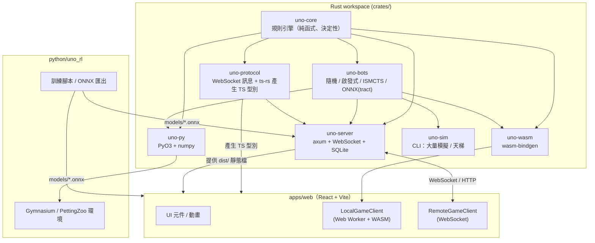

# 網頁版 UNO — 產品規格書 (SPEC)

> 版本：v1.0 · 決策已確認 · 實作者請先讀 [AGENTS.md](../AGENTS.md)

文件地圖（**全部都要讀**）：

| 文件 | 內容 | 何時讀 |
|------|------|--------|
| [SPEC.md](SPEC.md)（本檔） | 需求、架構、技術選型、畫面規格 | 開工前 |
| [RULES.md](RULES.md) | **每一條**遊戲規則與每個模式的牌組、計分（引擎唯一依據） | 寫引擎時 |
| [INTERFACES.md](INTERFACES.md) | Rust 型別、WASM API、Python API、RL 編碼、WebSocket 協議、DB Schema | 寫任何跨模組程式時 |
| [PLAN.md](PLAN.md) | 分階段、逐任務的實作步驟與驗收指令 | 每個任務開始前 |
| [PROGRESS.md](PROGRESS.md) | 實作進度勾選清單（實作者負責維護） | 每個任務結束後 |

---

## 1. 已確認的決策

| # | 問題 | 決定 |
|---|------|------|
| D1 | 引擎語言 | **Rust**。編譯成 WASM（瀏覽器）、原生（伺服器）、PyO3（Python）。只有**一份**規則程式碼。 |
| D2 | 帳號 | **要**。本機 SQLite；支援「註冊帳號」與「訪客（只輸入暱稱）」兩種。 |
| D3 | 部署 | **本地執行**。一支 Rust 伺服器執行檔同時提供網頁、WebSocket、API、資料庫。手機在同一個 Wi-Fi 下連線。 |
| D4 | RL 框架 | 主流：**Gymnasium**、**PettingZoo**、**Stable-Baselines3 + sb3-contrib（MaskablePPO）**、**PyTorch**（CleanRL 風格自我對戰腳本）、**ONNX** 匯出、**RLCard** 相容層。 |
| D5 | 手機 | **Mobile-first**：主機啟動時終端機印出 QR Code，手機掃描即可開始玩；直向操作優化；可加入主畫面（PWA）。 |

---

## 2. 需求清單

### 2.1 功能需求（編號會在 PLAN.md 中引用）

**遊戲**
- F1 經典 UNO 規則完整實作（[RULES.md §2](RULES.md)）。
- F2 房規選項（疊加、7-0、搶出、抽到能出為止、強制出牌、+4 質疑、UNO 懲罰…）（[RULES.md §3](RULES.md)）。
- F3 模式：經典、派對、Flip、No Mercy、團隊 2v2 / 3v3、淘汰賽、閃電、每日挑戰、自訂（[RULES.md §4](RULES.md)）。
- F4 2–10 人一桌。
- F5 單局制或累積分數制（預設 500 分）。

**對戰方式**
- F6 單機離線 vs AI（瀏覽器內執行，不需要伺服器連線）。
- F7 區網多人連線：建立房間、6 碼房號、QR Code 邀請、真人與 AI 混桌。
- F8 斷線重連（座位保留 60 秒，期間 AI 代打）。
- F9 觀戰。
- F10 房內聊天與快捷表情。

**AI**
- F11 AI 難度：簡單（隨機）、普通（啟發式）、困難（記牌 + ISMCTS）、研究型（載入 ONNX 模型）。

**帳號**
- F12 註冊 / 登入 / 訪客。
- F13 個人戰績：總場數、勝率、各模式 Elo、最近 50 場紀錄（可看重播）。
- F14 本機排行榜（各模式 Elo、每日挑戰分數）。

**強化學習**
- F15 Python 套件 `uno_engine`（PyO3 原生模組）與 `uno_rl`（Gymnasium / PettingZoo 環境）。
- F16 可重現：同 seed + 同動作序列 = 完全相同結果（跨 Python / 瀏覽器 / 伺服器）。
- F17 向量化環境（Rust 內批次執行，含內建 AI 對手），目標 ≥ 200,000 steps/s（單核，經典 4 人）。
- F18 訓練範例：MaskablePPO（SB3）、PPO 自我對戰（CleanRL 風格）、DQN（action mask）。
- F19 匯出 ONNX → 網頁與伺服器可直接載入成「研究型 AI」。
- F20 「AI 實驗室」頁面：選模型對戰、每步顯示動作機率。
- F21 重播格式在網頁、伺服器、Python 之間通用；網頁有重播檢視器。

**手機**
- F22 主機啟動後終端機與網頁大廳都顯示 QR Code（內容為 `http://<區網IP>:<port>/`；房間 QR 為 `/r/<房號>`）。
- F23 直向（portrait）為主要版面，橫向也可用；所有可點擊區域 ≥ 44×44 px。
- F24 觸控操作：點一下選牌、再點一下（或向上滑）出牌；震動回饋（支援的裝置）。
- F25 PWA manifest（可加入主畫面、全螢幕、圖示）；HTTPS 模式（選用）下可離線玩單機。
- F26 低階手機也要順暢：動畫可調速 / 關閉；遵守 `prefers-reduced-motion`。

### 2.2 非功能需求
- N1 畫面好看：統一設計系統（§5）、三套主題（經典、霓虹、極簡）。
- N2 效能：網頁首次載入 JS+CSS ≤ 400 KB gzip（WASM 另計，≤ 600 KB gzip；ONNX 模型延遲載入）；遊戲中 60fps。
- N3 安全：伺服器為權威，客戶端看不到他人手牌；密碼使用 argon2；所有輸入驗證。
- N4 測試：引擎覆蓋主要分支；property test；E2E 覆蓋主要流程（PLAN.md 每階段都有）。
- N5 i18n：繁體中文（預設）與英文。
- N6 無障礙：鍵盤可操作；色盲模式（每色附形狀符號）。

### 2.3 不做（v1）
雲端部署、金流、語音、原生 App、跨網際網路配對。

---

## 3. 系統架構



### 3.1 關鍵設計原則（實作者必須遵守）
1. **規則只寫在 `uno-core`**。前端、伺服器、Python 都不得自行判斷出牌是否合法，一律呼叫引擎的 `legal_actions`。
2. **引擎是純函式**：`apply(&mut state, player, action) -> Result<Vec<Event>, EngineError>`；不讀時間、不讀檔案、不用全域亂數。隨機性只來自 `GameState` 內的 `Rng`。
3. **UI 只有一條程式路徑**：畫面只吃 `PlayerView` + `Event[]`。單機與連線的差別只在 `GameClient` 實作（`LocalGameClient` vs `RemoteGameClient`），UI 元件不知道自己在哪種模式。
4. **跨語言型別自動產生**：WebSocket 訊息與 `PlayerView` 等型別定義在 Rust，用 `ts-rs` 產生到 `apps/web/src/generated/`，**禁止手寫重複型別**。
5. **時間相關規則（回合計時、閃電模式）由宿主處理**：伺服器 / LocalGameClient 計時，時間到時送系統動作 `Timeout` / `EndByTime` 給引擎。

### 3.2 目錄結構（最終）

```
UNO/
├─ AGENTS.md                  # 給實作 AI 的工作守則
├─ Cargo.toml                 # Rust workspace
├─ package.json               # pnpm workspace root
├─ pnpm-workspace.yaml
├─ crates/
│  ├─ uno-core/               # 規則引擎
│  ├─ uno-bots/               # AI
│  ├─ uno-protocol/           # 協議 + ts-rs
│  ├─ uno-wasm/               # 瀏覽器綁定
│  ├─ uno-py/                 # Python 綁定 (maturin)
│  ├─ uno-server/             # 伺服器執行檔
│  └─ uno-sim/                # 模擬 CLI
├─ apps/web/                  # 前端
│  └─ src/
│     ├─ generated/           # ts-rs 產生（勿手改）
│     ├─ wasm/pkg/            # wasm-pack 輸出（勿手改，git 忽略）
│     ├─ game/                # GameClient、動畫佇列、store
│     ├─ components/          # UI 元件（Card、Hand、Table…）
│     ├─ pages/               # 路由頁面
│     ├─ i18n/
│     └─ styles/
├─ python/
│  ├─ pyproject.toml
│  ├─ uno_rl/                 # Gym/PettingZoo env、wrappers
│  ├─ examples/               # 訓練腳本
│  └─ tests/
├─ models/                    # 匯出的 ONNX + metadata JSON
├─ data/                      # SQLite 資料庫（git 忽略）
├─ scripts/                   # dev.sh、build.sh、gen-types.sh…
└─ docs/
```

### 3.3 技術選型（主版本號固定，次版本取當時最新）

| 範疇 | 套件 |
|------|------|
| Rust | edition 2021、stable toolchain；`serde` 1、`serde_json` 1、`thiserror` 2、`proptest` 1（dev） |
| WASM | `wasm-bindgen` 0.2、`serde-wasm-bindgen` 0.6、`console_error_panic_hook`；工具 `wasm-pack` |
| Python 綁定 | `pyo3`（abi3-py310、extension-module）、`numpy`（rust crate，版本對應 pyo3）；工具 `maturin` |
| 伺服器 | `axum` 0.8（含 `ws`）、`tokio` 1、`tower-http`（fs、cors）、`rusqlite`（bundled）、`argon2` 0.5、`uuid`（v4）、`qrcode`、`local-ip-address`、`clap` 4、`tracing` |
| 型別產生 | `ts-rs` |
| ONNX（Rust） | `tract-onnx`（純 Rust，免安裝原生函式庫） |
| 前端 | React 19、Vite、TypeScript 5（strict）、Tailwind CSS 4（`@tailwindcss/vite`）、`motion`（Framer Motion）、`zustand` 5、`react-router` 7、`qrcode`、`howler`、`onnxruntime-web`（延遲載入）、`vite-plugin-pwa` |
| 前端測試 | Vitest、@testing-library/react、Playwright（含手機裝置模擬） |
| Python | Python 3.12（用 `uv` 建 venv）、`gymnasium>=1.0`、`pettingzoo>=1.24`、`numpy>=2`、`torch`、`stable-baselines3>=2.3`、`sb3-contrib`、`tensorboard`、`onnx`、`onnxruntime`、`pytest`；選用 `rlcard` |

> [!NOTE]
> 系統 Python 是 3.14，PyTorch 對新版 Python 支援可能較慢，因此 RL 環境固定用 `uv venv --python 3.12`。

---

## 4. 執行方式（最終使用者體驗）

```bash
# 一次性安裝
./scripts/setup.sh          # 安裝 rust、wasm-pack、pnpm 依賴、python venv
# 啟動
./scripts/start.sh          # 建置前端 + 啟動伺服器（預設 port 8787）
```

終端機輸出範例：

```
UNO server running
  本機:   http://localhost:8787
  區網:   http://192.168.1.23:8787   <- 手機掃描下方 QR Code
  ██████████████
  ██ ▄▄▄▄▄ █▀█ █ ...
```

手機掃描 → 開啟首頁 → 輸入暱稱（訪客）→ 加入房間或直接 vs AI。

開發模式：`./scripts/dev.sh`（Vite dev server `--host` + 伺服器 `cargo watch`，Vite 代理 `/api`、`/ws` 到 8787）。

HTTPS（選用，讓手機可安裝 PWA 與離線玩）：`./scripts/start.sh --https`，使用 `mkcert` 產生的憑證；說明寫在 README。

---

## 5. 畫面與互動規格

### 5.1 設計系統

**色彩（經典主題）**

| Token | Hex | 用途 |
|-------|-----|------|
| `--uno-red` | `#E53935` | 紅牌 |
| `--uno-yellow` | `#FDD835` | 黃牌 |
| `--uno-green` | `#43A047` | 綠牌 |
| `--uno-blue` | `#1E88E5` | 藍牌 |
| `--uno-black` | `#212121` | 萬用牌 |
| `--flip-pink` | `#EC407A` | Flip 暗面 |
| `--flip-teal` | `#26A69A` | Flip 暗面 |
| `--flip-orange` | `#FB8C00` | Flip 暗面 |
| `--flip-purple` | `#8E24AA` | Flip 暗面 |
| `--table-bg` | `#0F5132 → #0B3D26` 放射漸層 | 牌桌 |
| `--surface` | `rgba(255,255,255,0.08)` + `backdrop-blur` | 玻璃擬態面板 |
| `--accent` | `#FFC107` | 高亮、目前玩家光圈 |

霓虹主題：深色背景 `#0D0221`、卡牌外框發光（`box-shadow` 同色 0 0 12px）。極簡主題：白底、扁平卡牌、無陰影。

**色盲模式符號**：紅 ◆、黃 ●、綠 ▲、藍 ■（暗面：粉 ★、青 ✚、橘 ⬟、紫 ⬢），顯示在卡牌左上與右下角。

**字型**：`"Noto Sans TC", system-ui, sans-serif`；卡牌數字用 `"Fredoka", "Noto Sans TC"` 粗體（Google Fonts，打包到本地，**不從 CDN 載入**，因為要能離線）。

**圓角 / 陰影 / 間距**：卡牌圓角 = 寬度 × 0.1；卡牌陰影 `0 4px 10px rgba(0,0,0,.35)`；間距系統使用 Tailwind 預設 4px 單位。

### 5.2 卡牌（SVG 元件 `<UnoCard>`）
- viewBox `0 0 120 180`（2:3）。
- 結構：白色外框（圓角 12）→ 內部色塊（inset 8，圓角 8）→ 中央白色斜橢圓（旋轉 -30°，rx 42 ry 64）→ 中央符號（數字/圖示，填色 = 牌色）→ 左上與右下小符號（白色）。
- 萬用牌：中央橢圓分成紅黃綠藍四象限。
- 牌背：黑底、紅色斜橢圓、白色傾斜「UNO」字樣。
- 功能牌圖示（自己畫 SVG path）：Skip ⊘、Reverse 雙箭頭、+2 兩張疊牌、Wild 四色、+4 四張四色疊牌；變體卡用文字標籤（如 `+6`、`+10`、`ALL`）。
- 尺寸：`size` prop：`xs`(36px 寬，對手區)、`sm`(56px)、`md`(80px，手機手牌)、`lg`(110px，桌機手牌/中央棄牌堆)。
- 狀態：`playable`（上浮 8px + 外發光 accent）、`selected`（上浮 24px）、`disabled`（`opacity .55` + `saturate(.4)`）。

### 5.3 頁面清單與路由

| 路由 | 頁面 | 主要元素 |
|------|------|----------|
| `/` | 首頁 | Logo 動畫、暱稱輸入（訪客）或登入狀態、按鈕：「快速 vs AI」「建立房間」「加入房間」「每日挑戰」「AI 實驗室」「戰績」「設定」；右上顯示主機 QR（點擊放大） |
| `/login`、`/register` | 帳號 | 帳號、密碼表單；「以訪客身分繼續」 |
| `/solo` | 單機設定 | 選模式、玩家數、AI 難度（每個座位可個別設定）、房規抽屜 → 開始 |
| `/r/:code` | 房間大廳 | 座位網格（點空位加入 AI）、模式/房規（房主可改）、房間 QR + 複製連結、聊天、準備按鈕、房主「開始」 |
| `/game` | 遊戲桌 | §5.4 |
| `/results` | 結算 | 名次表、本局分數 / 累積分數、Elo 變化、「再來一局」「看重播」「回大廳」 |
| `/replay/:id` | 重播檢視器 | 播放/暫停、上一步/下一步、倍速、上帝視角切換、時間軸 |
| `/stats`、`/stats/:userId` | 戰績 | 總覽卡片、各模式 Elo 折線、最近對局列表 |
| `/leaderboard` | 排行榜 | 模式分頁、每日挑戰分頁 |
| `/lab` | AI 實驗室 | 選 ONNX 模型、對手、開局；遊戲中側欄顯示動作機率長條圖 |
| `/settings` | 設定 | 主題、牌背、音效音量、動畫速度（0.5x/1x/2x/關閉）、色盲模式、語言、震動開關 |
| `/rules` | 規則說明 | 各模式規則圖文 |

### 5.4 遊戲桌版面

**直向（手機，寬 < 768px 或 portrait）**

```
┌──────────────────────────────┐ ← safe-area-inset-top
│ ≡  經典 · 第3輪       ⏱ 12s  │ 頂部列 (48px)
├──────────────────────────────┤
│ (A)5  (B)7  [C]2!  (D)9  →   │ 對手列：頭像+手牌數，可橫向捲動；目前玩家金色光圈；UNO! 徽章
├──────────────────────────────┤
│                              │
│      ╭─方向環(旋轉)─╮          │
│      │ [牌堆] [棄牌]│          │ 中央區：點牌堆 = 抽牌
│      ╰─────────────╯          │ 目前顏色：棄牌堆後方光暈
│          +4 累積中             │ pendingDraw > 0 時顯示
├──────────────────────────────┤
│  輪到你了！                    │ 狀態提示列
│ ▕🂠🂠🂠🂠🂠🂠🂠🂠▏  ← 可橫向捲動     │ 手牌：重疊扇形，可出的牌上浮
│                    (UNO!)     │ UNO 浮動按鈕 64px，右下
└──────────────────────────────┘ ← safe-area-inset-bottom
```

**橫向 / 桌機（寬 ≥ 768px 且 landscape）**：橢圓牌桌，對手依座位平均分佈在上半橢圓；自己在下方；聊天側欄可收合。

**手牌排序**：依顏色（紅黃綠藍黑）再依數字/種類排序；設定中可切換「依顏色」「依數字」。

**手牌重疊規則**：可用寬度 W、牌寬 w、張數 n：間距 `step = min(w * 0.75, (W - w) / (n - 1))`；若 `step < w * 0.28` 改為可橫向捲動（step 固定 `w*0.28`）。

### 5.5 互動
- **出牌（觸控）**：點可出的牌 → 選取（上浮）；再點同一張 → 出牌；或選取後向上滑動 > 40px → 出牌。點其他地方取消選取。
- **出牌（滑鼠）**：點擊可出的牌直接出牌；或拖曳到中央棄牌堆。
- **鍵盤**：←/→ 移動焦點、Enter 出牌、D 抽牌、U 喊 UNO、1–4 選色。
- **萬用牌**：出牌後彈出選色面板（4 個大色塊，各 ≥ 72px，色盲模式顯示符號）。
- **抽到可出的牌**：彈出「出這張 / 保留」兩個按鈕，抽到的牌在中央放大顯示。
- **+4 質疑**：彈出「質疑 / 接受」與倒數。
- **7-0 換牌**：對手頭像變成可點選目標並閃爍。
- **UNO**：手牌剩 2 張且輪到自己時，UNO 按鈕脈動提示；別人剩 1 張且未喊時，其頭像出現「抓！」按鈕。
- **震動**：輪到自己 `vibrate(30)`、被罰抽 `vibrate([40,30,40])`（設定可關閉；`navigator.vibrate` 不存在時忽略）。
- **防誤觸**：遊戲頁禁止雙擊縮放（`touch-action: manipulation`）、禁止長按選字（`user-select: none`）、離開頁面前確認。
- **螢幕常亮**：支援時使用 Screen Wake Lock API（需 HTTPS 或 localhost，不支援則略過）。

### 5.6 動畫（依引擎事件播放）

| 事件 | 動畫 | 時長(1x) |
|------|------|----------|
| `RoundStarted` / 發牌 | 牌從牌堆依序飛到各玩家 | 每張 60ms |
| `CardPlayed` | 牌飛向棄牌堆中央，隨機旋轉 ±15°，落地縮放 1.1→1 | 350ms |
| `CardsDrawn` | 牌背從牌堆飛向該玩家（自己的會翻面） | 每張 120ms |
| `DirectionChanged` | 方向環旋轉 180° 並改變箭頭 | 500ms |
| `ColorChosen` | 棄牌堆光暈漣漪擴散成新顏色 | 400ms |
| `PlayerSkipped` | 該玩家頭像出現 ⊘ 並搖晃 | 400ms |
| `UnoCalled` | 「UNO!」大字彈出 + 音效 | 700ms |
| `UnoPenalty` | 紅色「被抓到！」 | 600ms |
| `HandsSwapped` / `HandsRotated` | 手牌區淡出淡入 + 箭頭 | 600ms |
| `SideFlipped`（Flip） | 所有牌 3D rotateY 180° | 700ms |
| `RoundEnded` | 勝利者彩帶 + 分數跳動 | 1500ms |

動畫佇列 (`AnimationQueue`) 依序播放事件；播放期間收到的新事件排隊；速度設定乘以時長；「關閉」時直接套用最終畫面。**畫面狀態以最新 `PlayerView` 為準**，動畫只是過場。

### 5.7 音效
出牌、抽牌、UNO!、勝利、輪到你、錯誤 6 種，放 `apps/web/public/sounds/`（自行用免版權音效或程式合成，記錄來源於 `CREDITS.md`）。

---

## 6. 帳號與戰績
- 訪客：首頁輸入暱稱 → `POST /api/guest` → 取得 token（存 localStorage）。訪客也有 user 紀錄（`is_guest=1`），可之後「升級」成正式帳號（設定帳密，保留戰績）。
- 正式帳號：使用者名稱 3–20 字（英數、底線、中文）、密碼 ≥ 6 字，argon2 雜湊。
- Token：隨機 32 bytes base64url，存 `sessions` 表，30 天有效；HTTP 用 `Authorization: Bearer`，WebSocket 在 `Hello` 訊息帶入。
- 戰績：每局結束伺服器寫入 `matches`、`match_players`，並更新 `ratings`（Elo，K=32，多人局拆成兩兩對比平均）。
- 單機（離線）對局：結束時若有連線，前端把重播上傳 `POST /api/matches/solo`，伺服器**用引擎重跑重播驗證**後才計入戰績（AI 對手不計 Elo，只計勝場）。

---

## 7. 強化學習（摘要，細節見 INTERFACES.md §5）
- `uno_engine.Game`：單局，完整控制（研究者自訂迴圈）。
- `uno_rl.UnoEnv`（Gymnasium）：單一學習者，其他座位由內建 AI 扮演（Rust 執行）。
- `uno_rl.env()` / `uno_rl.parallel_env()`（PettingZoo AEC）：多智能體自我對戰。
- `uno_rl.make_vec_env(n)`：Rust 內批次執行的向量環境（SB3 `VecEnv` 介面）。
- 觀測：固定長度 `float32` 向量 + `action_mask`（`bool`）。
- 行動：離散，大小依模式（經典 81、No Mercy 95、Flip 135）。觀測：經典 295 維。
- 獎勵：`win_loss`（預設）、`score`、`rank`，可傳入自訂函式（吃事件列表）。
- 模型匯出：`uno_rl.export_onnx(policy, path)` 產生 `.onnx` + `.json`（含模式、觀測版本、行動大小）。

---

## 8. 品質門檻（每個 PR / 任務都要過）
```bash
cargo fmt --all --check
cargo clippy --workspace --all-targets -- -D warnings
cargo test --workspace
pnpm -C apps/web lint && pnpm -C apps/web typecheck && pnpm -C apps/web test
python/.venv/bin/pytest python/tests     # Phase 7 起
```
